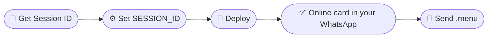

<div align="center">


<br/>


<br/><br/>


</div>

<br/>

## ⚡ How it works



<br/>

## 🔑 Step 1: Get your Session ID

<div align="center">

| 🟢 Pair Site 1 | 🟢 Pair Site 2 |
|:-:|:-:|
| [](https://klaus-xmd-kge2.onrender.com/) | [](https://klaus-session-pair.vercel.app) |

</div>

1. Open a pair site and choose **Pairing Code** or **QR Code**.
2. In WhatsApp go to **Settings → Linked Devices → Link a Device**.
3. Enter the code (or scan the QR). Your **SESSION_ID** appears on the page **and is sent to your own WhatsApp chat**.

> [!CAUTION]
> Your SESSION_ID gives full access to your WhatsApp account. **Never share it, post it in logs or issues, or commit it to GitHub.** If it leaks, unlink the device in *Linked Devices* and generate a new one.

<br/>

## 🚀 Step 2: Deploy

<div align="center">

[](https://railway.app/new/template?template=https://github.com/Nester01-F/KLAUS-XMD)
[](https://heroku.com/deploy?template=https://github.com/Nester01-F/KLAUS-XMD)
[](https://render.com/deploy?repo=https://github.com/Nester01-F/KLAUS-XMD)
[](https://app.koyeb.com/deploy?type=git&repository=github.com/Nester01-F/KLAUS-XMD)

</div>

### 🔧 Environment variables

| Variable | Required | What it is |
|:--|:-:|:--|
| `SESSION_ID` | ✅ | The Session ID from Step 1 |
| `OWNER_NUMBER` | ➖ | Your number with country code, no `+` (e.g. `2547XXXXXXXX`) |

### 💻 Run it yourself

```bash
git clone https://github.com/Nester01-F/KLAUS-XMD.git
cd KLAUS-XMD
npm install
SESSION_ID="your_session_id" node index.js
```

No session yet? Run `node index.js` with no `SESSION_ID` and choose **QR** or **Pairing Code** in the terminal.

<details>
<summary><b>🟣 Heroku notes</b></summary>

<br/>

The `Procfile` runs the bot as a **worker**, so turn the web dyno off and the worker on:

```bash
heroku ps:scale web=0 worker=1
heroku config:set SESSION_ID="your_session_id"
heroku logs --tail
```

Run **one copy per session**. Two bots on the same Session ID log each other out.

</details>

<br/>

## 🌟 Why KLAUS XMD?

<table>
<tr>
<td width="50%" valign="top">

### ⚡ Fast &amp; Reliable
- Multi-device **Baileys** core
- Hot-reload plugins, no restart needed
- Smart reconnect with backoff
- Built-in keep-alive pings

### 🛡️ Group Guard
- **Antilink**: detects and deletes links
- **Antispam**: rate-limits spammers
- **3-Strike System**: auto-kick after warnings
- **Per-group settings** for every chat

</td>
<td width="50%" valign="top">

### 🤖 Automation
- Auto view &amp; save **status**
- Auto react to status and commands
- Auto read, auto typing, auto bio
- Auto block and call handling

### 🎨 Beautiful Output
- Custom menu with images
- Neon-styled replies
- Image-backed command cards
- Online card sent on startup

</td>
</tr>
</table>

<br/>

## 📦 Feature Highlights

<div align="center">

| 🎯 Category | 🔥 Power |
|:-----------:|:---------|
| **Downloaders** | YouTube · TikTok · Instagram · Facebook · Spotify · Twitter · Pinterest |
| **AI Tools** | GPT · Gemini · Image Generation · Summarizer |
| **Stickers** | Image→Sticker · Video→Sticker · Sticker→Image |
| **Group Admin** | Kick · Promote · Tagall · Mute · Antilink · Antispam |
| **Automation** | Auto view status · react · read · typing · bio · block |
| **Tools** | Weather · Translate · QR · Time · Lyrics · Currency · IP Lookup |
| **Fun** | Memes · Jokes · 8Ball · Ship · Dice · Coin Flip |

</div>

Send **`.menu`** in any chat to see everything the bot can do.

<br/>

## 📸 Preview

<div align="center">

| 🎨 Menu | ⚡ Alive | 👑 Developer |
|:-------:|:--------:|:-------------:|
|  |  |  |

</div>

<br/>

## 👨‍💻 Developer

<div align="center">


### 🥷 Warrior Felix

**Founder · KLAUS TECH · Nairobi, Kenya 🇰🇪**

<a href="https://wa.me/254701881604"></a>
<a href="https://wa.me/254725391914"></a>
<a href="https://github.com/Nester01-F"></a>

<br/><br/>


</div>

<br/>

## ❤️ Support the Project

<div align="center">

If **KLAUS XMD** helped you, please ⭐ **star** the repo and 🍴 **fork** it!

<a href="https://github.com/Nester01-F/KLAUS-XMD/stargazers"></a>
<a href="https://github.com/Nester01-F/KLAUS-XMD/fork"></a>
<a href="https://github.com/Nester01-F/KLAUS-XMD/issues"></a>

<br/><br/>

<a href="https://star-history.com/#Nester01-F/KLAUS-XMD&Date">
  
</a>

</div>

<br/>

## ⚠️ Disclaimer

> KLAUS XMD is provided **as-is** for educational purposes and is **not affiliated with or endorsed by WhatsApp or Meta**.
> Do not use it for spam, harassment, or any activity that violates **WhatsApp's Terms of Service**.
> The developer is **not responsible** for misuse or account bans.

<div align="center">

<br/>


### 🇰🇪 **MADE IN KENYA** 🇰🇪

**By [Warrior Felix](https://github.com/Nester01-F) · KLAUS TECH**

⭐ **Star · Fork · Deploy · Enjoy** ⭐


</div>